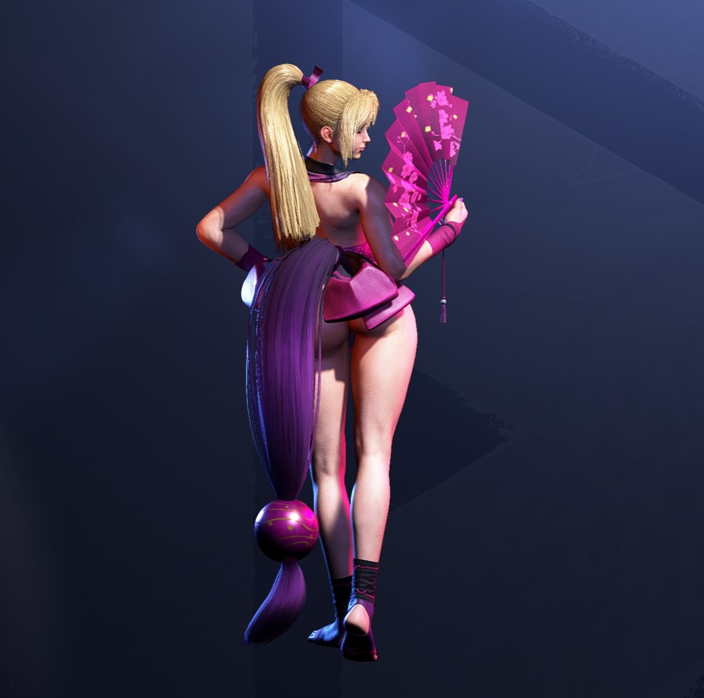
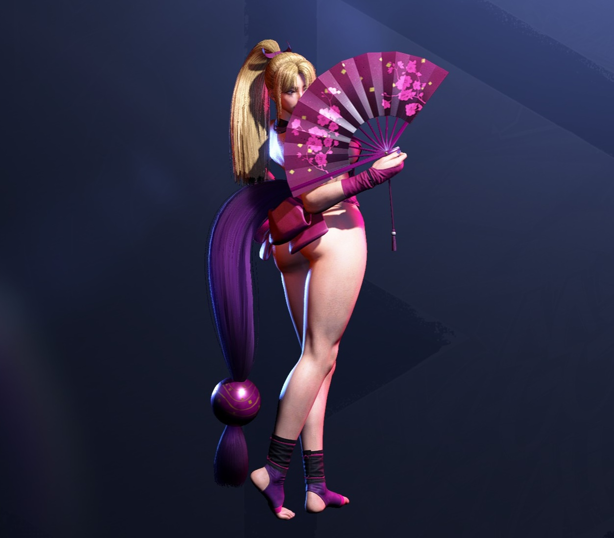
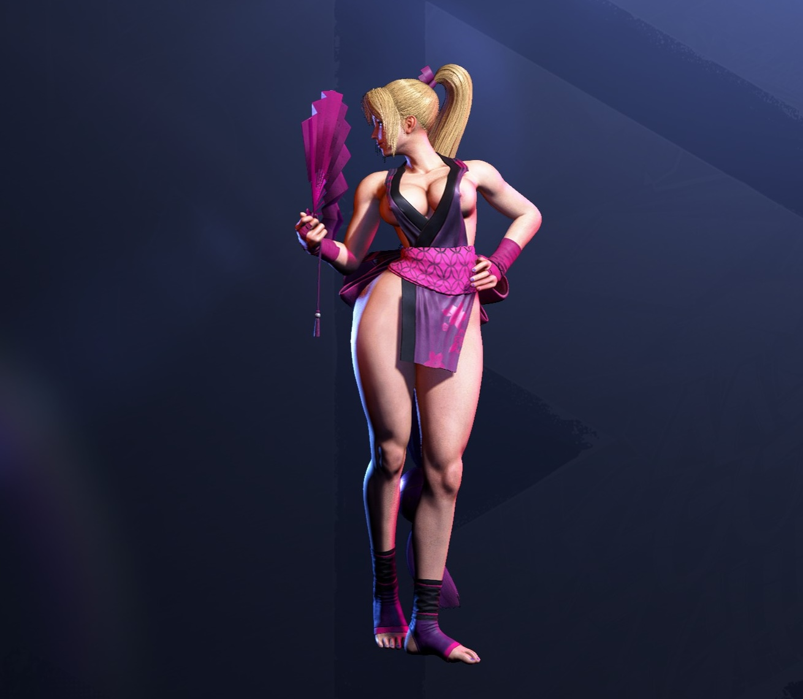
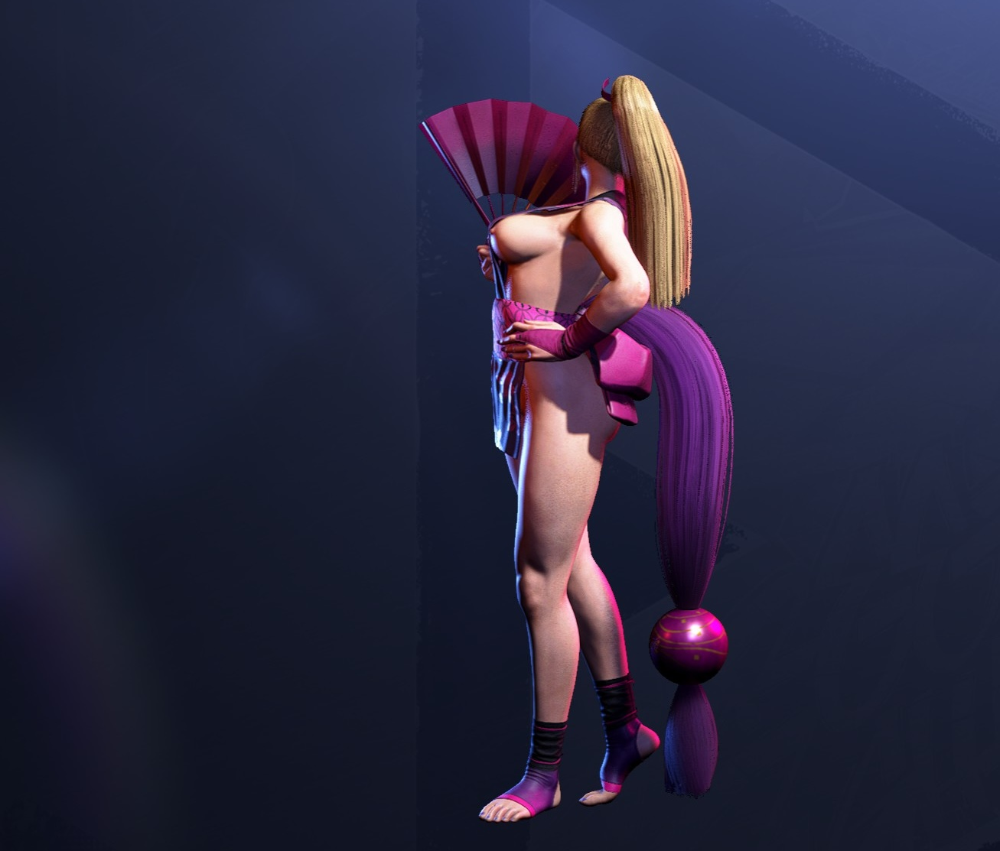
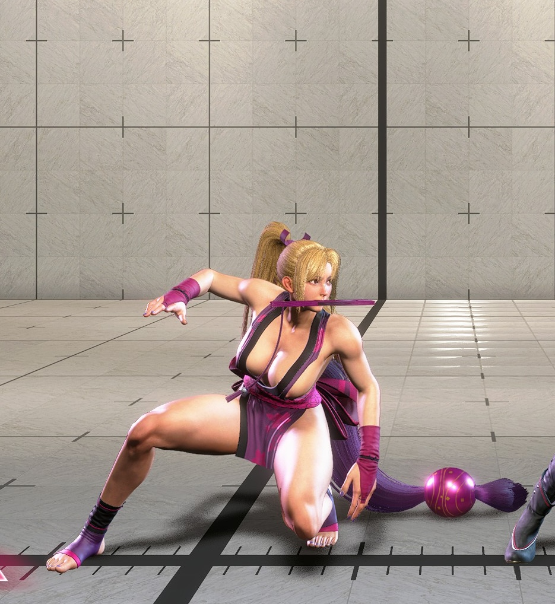
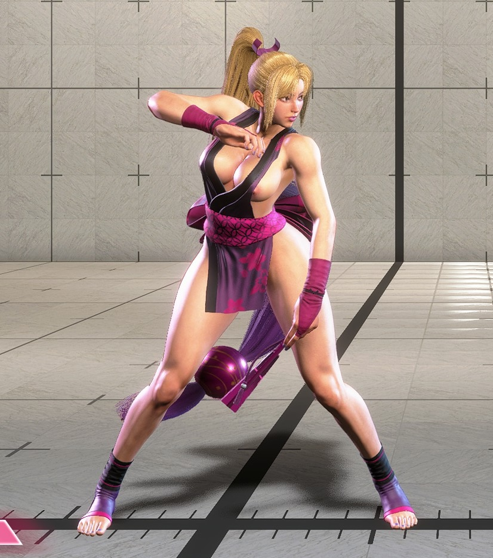
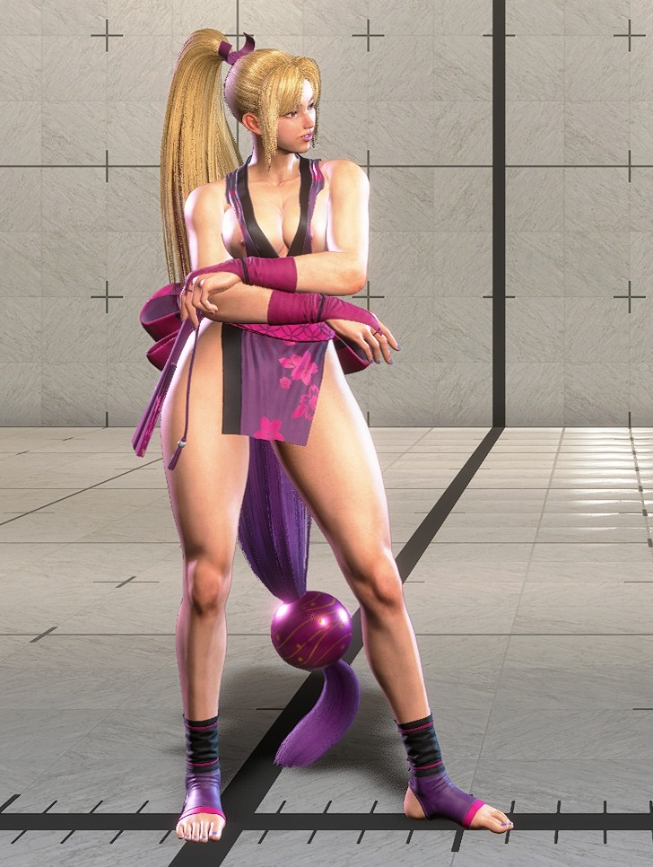

# Mai C1 Edit

**By G80M3 on GitHub / Diamond Fountain Works on Nexus Mods**

[Diamond Fountain Works](https://github.com/Diamond-Fountain-Works) · [G80M3](https://github.com/G80M3)

**Pubic Hair / No Pubic Hair**

[Download v1.0.1](https://github.com/G80M3/sf6-mai-c1-edit/releases/tag/v1.0.1)

| Variant | Download |
| --- | --- |
| Pubic Hair | [Mai-C1-Edit-Pubic-Hair-v1.0.1.zip](https://github.com/G80M3/sf6-mai-c1-edit/releases/download/v1.0.1/Mai-C1-Edit-Pubic-Hair-v1.0.1.zip) |
| No Pubic Hair | [Mai-C1-Edit-No-Pubic-Hair-v1.0.1.zip](https://github.com/G80M3/sf6-mai-c1-edit/releases/download/v1.0.1/Mai-C1-Edit-No-Pubic-Hair-v1.0.1.zip) |

## Screenshots / 游戏截图

<table>
  <tr>
    <td></td>
    <td></td>
  </tr>
  <tr>
    <td></td>
    <td></td>
  </tr>
  <tr>
    <td></td>
    <td></td>
  </tr>
  <tr>
    <td colspan="2" align="center"></td>
  </tr>
</table>

## 中文

Mai C1 服装编辑。收窄胸前布条、调整前片轮廓、缩短 Obi，沿用原有贴图。

提供 **Pubic Hair** 和 **No Pubic Hair** 两个版本。服装和身体网格一致，仅毛发选项不同。

选择一个 ZIP，通过 **Fluffy Mod Manager** 安装，在游戏中选择 **Mai C1**。

## English

A Mai C1 costume edit. Features narrower top panels, a revised front panel, and a shorter Obi, retaining the original textures.

Available in **Pubic Hair** and **No Pubic Hair** variants. Both share the same clothing and body meshes; only the added hair differs.

Choose one ZIP and install with **Fluffy Mod Manager**, then select **Mai C1** in-game.

## Credits

- G80M3 on GitHub / Diamond Fountain Works on Nexus Mods — model edits, variant preparation and mod packaging.

我也做软件和工具开发，欢迎来我的 [GitHub](https://github.com/G80M3) 看看。

I also develop software and tools. Check out my other work on [GitHub](https://github.com/G80M3).

[ZIP checksums / 校验值](RELEASE_SHA256SUMS.txt)
